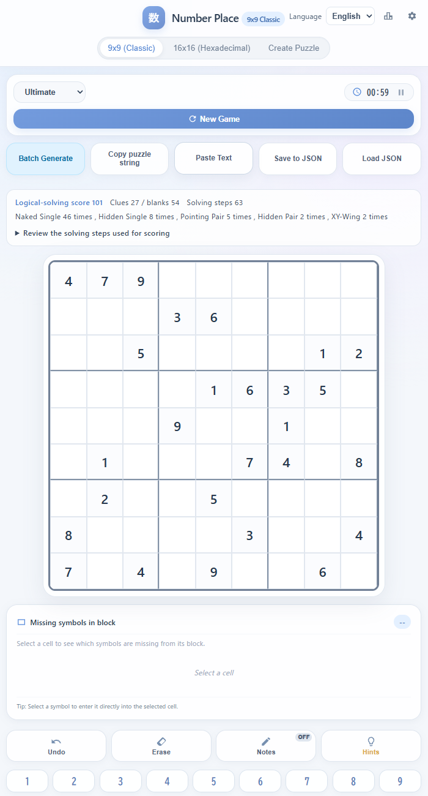
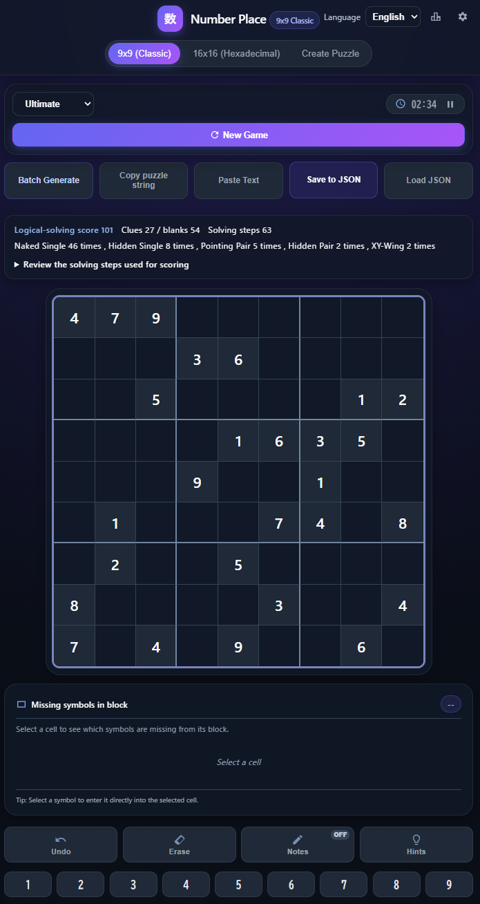
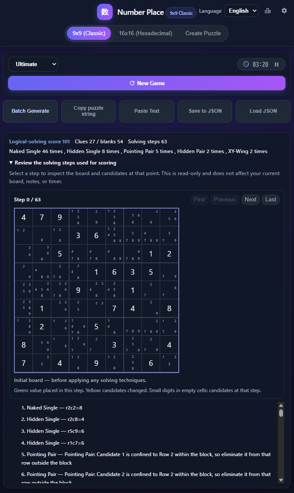
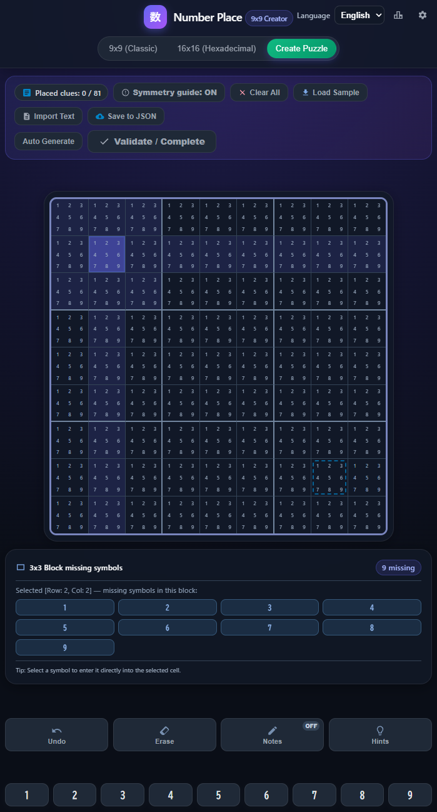
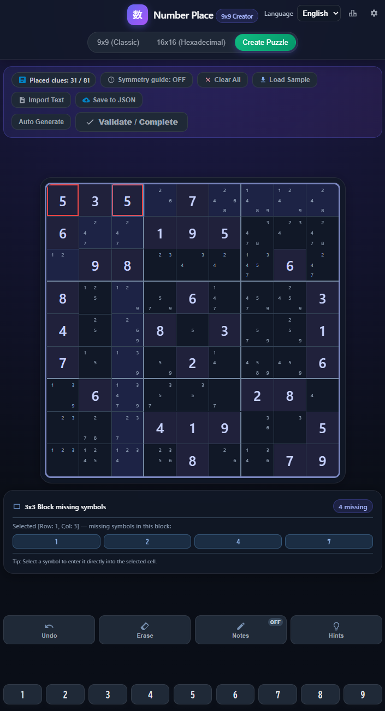
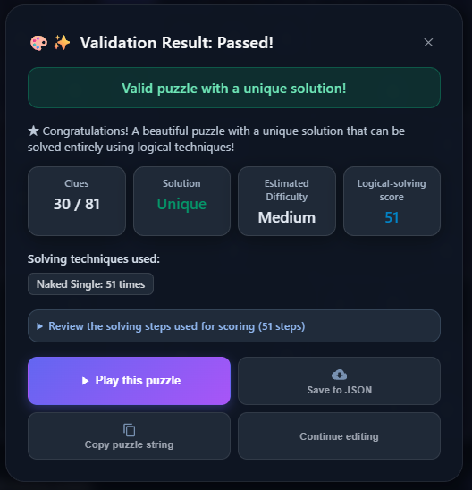
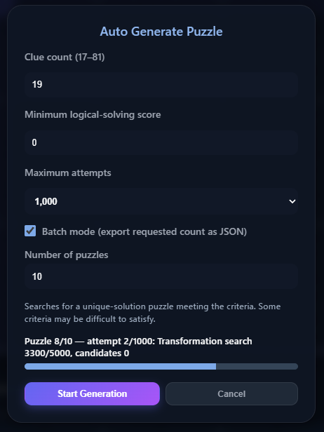

# Sudoku-game-and-tools
(The following text is an AI translation of the original Japanese text below.)

## Notice
* This application was generated with the assistance of Gemini and ChatGPT.
* THIS APPLICATION IS PROVIDED "AS IS". IN NO EVENT SHALL THE AUTHOR BE LIABLE FOR ANY CLAIM, DAMAGES OR OTHER LIABILITY ARISING FROM THE USE OF THIS APPLICATION.
* This application was developed for personal use by an amateur with no programming experience to enjoy Number place(Sudoku). There are no plans for major future feature additions or bug fixes, and individual bug reports, feature requests, or improvement suggestions will not be supported.

## Overview
This application is a browser-based Sudoku (Number Place) game that works completely offline.
* Play 9x9 and 16x16 number place puzzles.
* Create custom puzzles using the Create Puzzle mode.
* Offline generation of puzzles with 19 or more clues via auto-generation.

## Tested Environment
* Tested on Desktop PC + Google Chrome.
* Operation on smartphones and tablets has not been verified and is not guaranteed.

## Key Features
**Game Modes**
* **9x9 Sudoku**: Easy, Normal, Hard, Expert, Ultimate
* **16x16 Sudoku**: Easy, Normal, Hard
* **Create Puzzle Mode**

**Functions**
**Gameplay**
* Undo, Erase, Memo, Hint, Display unplaced numbers within 3x3 blocks, Dark mode
* Copy/Paste puzzle string
* Save/Load game data via JSON (Undo is supported even in saved data)
* Ultimate mode only: Logical solving steps display, continuous batch generation of high-difficulty boards

**Create Puzzle Mode**
* Symmetry guide, Clear all, Duplicate number warnings
* Unique solution check, Basic difficulty evaluation
* Copy puzzle string
* Save board as JSON
* Auto-generate boards (19+ clues)
* Seamless transition to gameplay after board completion

## Usage
Download the HTML file and open it in your web browser.

## Uninstallation
Delete the downloaded file(s).

## Ultimate Mode
Ultimate mode is a mode for selecting and generating high-difficulty boards with 27 clues.

### Ultimate Mode Board Generation Conditions
* Must have 27 clues and 54 empty cells (same as Expert mode).
* Solution must be unique.
* Cannot be solved using only basic techniques like Singles.
* Must use at least one advanced technique such as Pairs, Triples, X-Wing, XY-Wing, or Swordfish.
* Must be solvable to the end using only supported logical solving methods.

  

### Logical Solving Score
The logical solving score displayed in this application is a unique score calculated by weighting each step according to the technique used (see table below). Since this score does not necessarily represent subjective difficulty, please use it only as a rough guide where a higher score indicates a tendency toward greater difficulty.
| Technique | Points |
| :--- | :---: |
| Naked Single | 1 |
| Hidden Single | 1 |
| Locked Candidate | 3 |
| Pointing Pair | 3 |
| Pointing Triple | 3 |
| Naked Pair | 4 |
| Hidden Pair | 5 |
| Naked Triple | 6 |
| Hidden Triple | 7 |
| Naked Quad | 8 |
| Hidden Quad | 9 |
| X-Wing | 9 |
| Remote Pair | 10 |
| XY-Wing | 11 |
| Swordfish | 12 |
| XYZ-Wing | 12 |
| Jellyfish | 15 |
* In this mode, you can check the step-by-step solving procedure generated by the logical solver by clicking "Review the solving steps used for scoring".
* The solving steps display can also be turned off in the settings.

## Create Puzzle Mode
A tool for creating your original puzzles.

* Each cell displays its available candidate numbers, which update dynamically as you enter numbers. If there are overlapping numbers in the same row, column, or 3x3 block, the cells turn red as a warning.
* Clicking "Validate/Complete" checks whether the created board has any issues (unique solution check, presence of logical solving steps).
* In Create Puzzle Mode, you can auto-generate boards by specifying the number of clues and the minimum logical solving score.
* Since the auto-generator builds boards on the fly without using databases, generation may fail if the clue count is below 19 (even though 17 can be specified).
* Setting the minimum logical solving score too high may also cause generation to fail, so please set appropriate values matching the clue count.

> **⚠️ Notes on Auto-Generating Low-Clue Puzzles**
> * Generating low-clue puzzles like 19-clue boards can take time. On the author's environment (Core i7-12700K) with 19 clues and a minimum logical solving score of 0, generation takes from 1 minute to several minutes.
> * Depending on your PC environment, it may take even longer, and continuous batch generation may cause high load and heating, so please be cautious.
> * Auto-generation is not recommended on smartphones or tablets as operation has not been verified and it may drain the battery quickly.

## UI Guide
* **Language**: Choose between English and Japanese.
* **Statistics (Bar chart icon)**: Records play counts and fastest times for each mode.
* **Settings (Gear icon)**: Toggle various game settings ON/OFF.
* **Board Selection**: Choose between 9x9, 16x16, and Create Puzzle mode.
* **Timer Display**: Click the pause button to pause the game.
* **New Game**: Creates a new board.
* **Continuous Generation**: In Ultimate mode, generates a specified number of boards sequentially and saves them to JSON files. OFF by default, can be turned ON in settings.
* **Copy Board Text**: Copies the puzzle string as text.
* **Paste Text**: Pastes and recreates a copied puzzle string.
* **Save/Load JSON**: Saves and loads current game progress. Because data is saved in JSON format, moving the save file allows you to continue playing the same board on another device or share the same board with others. Files are saved to your browser's default download location.
* **Undo**: Reverts to the previous step.
* **Erase**: Clears the entered number.
* **Memo**: When ON, selecting a cell and entering numbers will add them as memos.
* **Hint**: Select a cell and click to fill in the correct answer for that cell.

## License
[MIT License](LICENSE)

## Disclaimer
* This application is provided "As-Is" without any warranties of any kind, including warranties of merchantability or fitness for a particular purpose.
* The author assumes no responsibility for any damages whatsoever arising from the use or inability to use this application.
* This application was created for the author's personal use, and the author cannot accommodate individual feature addition requests or bug-fix support.
---

## 注意事項
本アプリは、Gemini / Chat GPTとの協力により生成されました
本アプリは自己責任で使用してください。使用・使用不能よって生じた損害に作者は一切責任を負いません
本アプリは、プログラム経験が皆無な素人が、ナンプレを遊ぶために個人用に開発したものであり、
今後の大きな機能追加や不具合修正の予定はありません、また個別の不具合、改善要望、機能追加には対応できません

## 本アプリの概要
本アプリは完全オフライン動作のブラウザベースナンプレアプリです
9x9,16x16のナンプレで遊べます
盤面クリエイトモードでオリジナル盤面の作製が可能です
オート生成でヒント数19以上の盤面のオフライン生成が可能です

## 動作確認
動作確認は、デスクトップPC+Google Chromeで行いました
スマホ、タブレットでの動作は未検証のため保証しません

## 主な機能
**ゲームモード**
・9x9ナンプレ:  難易度-簡単, 普通, 難しい, エクストリーム, Ultimate
・16x16ナンプレ: 難易度-簡単, 普通, 難しい
・盤面クリエイトモード
**機能**
**ゲームプレイ**
・元に戻す,消去,メモ,ヒント,3x3ブロック内未配置数字表示
・盤面テキストコピー/貼り付け
・ゲームデータJSON保存/読み込み(セーブデータでもUndo対応)
・Ultimate modeのみ論理解法手順表示, 高難度盤面連続生成

**盤面クリエイトモード**
・点対称ガイド,全クリア, 重複数字警告
・一意性、簡易難易度判定
・盤面テキストコピー
・盤面JSON保存
・盤面オート生成(ヒント数19~)
・盤面完成後シームレスプレイ対応

## 起動方法
　HTMLファイルダウンロードしブラウザで開いてください
 
## アンインストール
　ダウンロードしたファイルを削除してください

## Ultimate modeの説明
Ultimateモードは、27ヒントの高難度盤面を選択生成するモードです。
**Ultimateモード盤面生成条件**
・ヒント27個・空欄54個(エキスパートモードと同じ)であること
・解が一意であること
・シングルなどの基本解法だけでは解き切れないこと
・ペア、トリプル、X-Wing、XY-Wing、Swordfishなどの高度な解法を少なくとも1種類使うこと
・対応する論理解法だけで最後まで解けること

Ultimateモードで表示される論理解法スコアは、論理解法1ステップごとに、下表の技法に応じて重みをつけて加算し算出した独自のスコアです
体感難易度の違いを意味するスコアではないため、高いほど難しい傾向がある程度にお考え下さい。
|技法|加点
|:-----|:-----:|
| Naked Single(裸のシングル) | 1 |
|         Hidden Single(隠れシングル)         |  1 |
|         Locked Candidate(ロック候補)         |  3 |
|                     Pointing Pair(ポインティングペア)                    |  3  |
|                                 Pointing Triple(ポインティングトリプル)                                |   3  |
|                                               Naked Pair(裸のペア)                                              |   4   |
|                                                       Hidden Pair(隠れペア)                                                      |    5   |
|                                                               Naked Triple(裸のトリプル)                                                               |    6    |
|                                                                         Hidden Triple(隠れトリプル)                                                                         |    7    |
|                                                                                    Naked Quad(裸のクアッド)                                                                                   |     8    |
|                                                                                    Hidden Quad(裸のクアッド)                                                                                   |     9     | 
|                                                                                             X-Wing                                                                                             |      9     | 
|                                                                                                Remote Pair(リモートペア)                                                                                                |      10     | 
|                                                                                                          XY-Wing                                                                                                         |      11     | 
|                                                                                                             Swordfish                                                                                                             |      12     | 
|                                                                                                                  XYZ-Wing                                                                                                                 |      12     | 
|                                                                                                                      Jellyfish                                                                                                                     |      15     |                                                                                                                      

 　本モードでは、”採点に使った解法手順を見る”で、論理解法エンジンによる解法手順をステップバイステップで確認することが可能です
 解法手順表示は設定でOFFにすることも可能です
 
## 盤面クリエイトモードの説明
オリジナルの盤面を作成するためのツールです
 
各枠には入力可能な数字が記されており、数字を入力すると、他枠の入力可能数字が連動して変化します。また、同一行、列や各3x3ブロックに数字の重なりがあると、警告のため枠が赤くなります。

盤面を作成し、”パズル判定・完成”を押すと、作成した盤面に問題がないか判定されます(一意性判定、論理解法手順の有無)。

盤面クリエイトモードでは、ヒント数及び最低論理解法スコアを指定した盤面のオート生成が可能です

本アプリのオート生成では、データベース等は使わず盤面をその場生成しておりますので、ヒント数は17から指定できるものの、現状ではヒント数が19以上でないと生成に失敗します
また、最低論理解法スコアを高くしすぎても生成に失敗しますので、ヒント数に合わせ適切な値を設定してください

 (注意：本アプリの論理解法エンジンは、Ultimateモードの説明中に記した技法以外の高度なテクニック、例えばAIC、Unique Rectangles等には対応しておりませんので、それらが必要となるような盤面の場合には、途中で解けなくなったとか、仮置き・試行錯誤推論が必要と判定される可能性がありますのでご了承ください。）
   
**少ヒント問題のオート生成に関する注意事項**
19ヒント等の少ヒント問題は生成に時間がかかる場合があります
作者の環境Core-i7-12700Kでヒント数19, 最低論理解法スコア0としたとき、生成に1分~数分かかります
お使いのPC環境によっては、さらに時間がかかる場合もあり、高負荷による発熱等の可能性もありますので多枚数の連続生成においてはご注意ください
また、スマホ、タブレット等では動作検証しておりませんのでオート生成は非推奨とさせていただきます（バッテリーも減りやすいと思うので）

## UIの説明  
* **言語**：表示言語を英語と日本語から選べます。

* **統計情報(棒グラフマーク)**：各モードのプレイ回数と最速タイムが記録されます。

* **設定(歯車マーク)**：各ゲーム設定のON/OFFを切り替えることができます。

* **盤面選択**：9x9、16x16、盤面クリエイトモードを選ぶことができます。

* **モード選択**：9x9モードでは簡単、普通、難しい、エキスパート、Ultimate、16x16モードでは簡単、普通、難しいから選択できます。

* **タイム表示**：一時停止ボタンを押すとゲームが一時停止できます。

* **新規ゲーム**：クリックすると新しい盤面が作成されます。

* **連続生成**：Ultimateモードで、指定回数分盤面を生成しJSONファイルに保存します。デフォルトではOFFになっており、設定でONにできます。

* **盤面テキストをコピー**：盤面配列をテキストコピーします。

* **テキスト貼り付け**：コピーした盤面配列を貼り付け再現します。

* **JSONに保存,JSONを読み込む**：ゲームの途中経過の保存と読み込みができます。JSON形式での保存なので、セーブファイルを移動すると別デバイスでも同じ盤面の続きをプレイしたり、他の人と同じ盤面を共有したりすることが可能です。ファイルはブラウザの既定の保存場所に保存されます。

* **元に戻す**：クリックすると前の手順に戻ります。

* **消去**：入力した数字を消去します。

* **メモ**：ONの状態で枠を選択し、数字を入力するとメモが入力されます。

* **ヒント**：枠を選択してクリックすると、その枠の解が入力されます。

   
## Licence
MIT License

## 免責事項
・本アプリは現状のまま（As-Is）提供されるものであり、動作保証や特定の目的への適合性を含め、いかなる保証も行いません
・本アプリの使用・使用不能によって生じた一切の損害について、作者は一切の責任を負いません
・本アプリは作者個人用に作成されたものであり、個別の機能追加要望や、不具合対応に応じることはできません

Copyright © 2026 Isna2026 All rights reserved.

